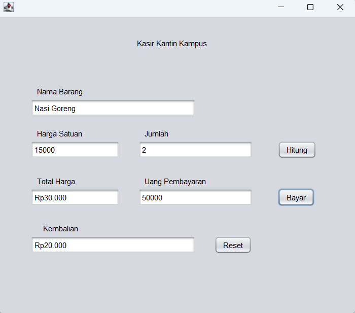
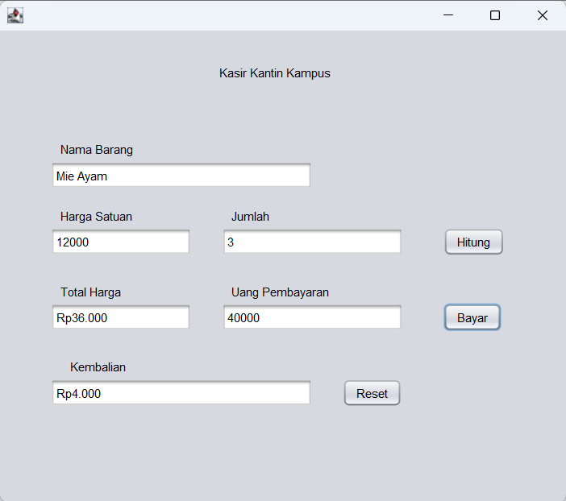
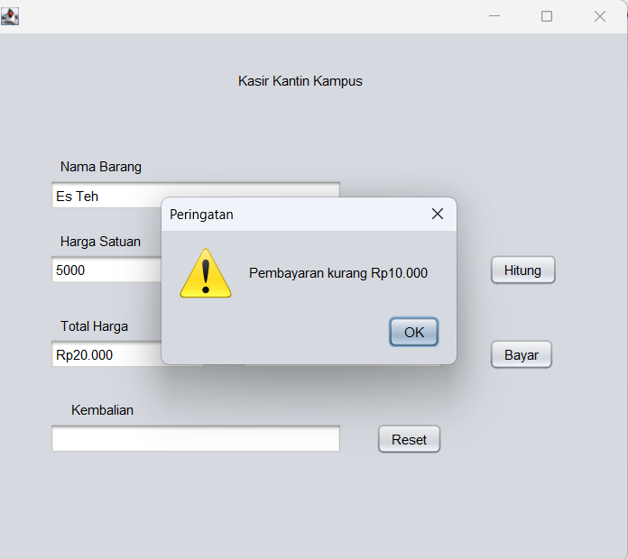

## Identitas
- **Nama Lengkap** : Akbar Syam Al Ghamar
- **NIM**          : C2483207013
- **Mata Kuliah**  : Pemrograman Visual

## Nama Aplikasi
Kasir Kantin Kampus

## Deskripsi Singkat
Aplikasi desktop berbasis Java Swing untuk mencatat satu jenis makanan atau
minuman per transaksi, menghitung total harga, menerima pembayaran, dan
menghitung kembalian. Aplikasi tidak menggunakan database.

## Fitur
- Input nama barang, harga satuan, jumlah, dan uang pembayaran
- Hitung total harga (harga x jumlah)
- Hitung kembalian (pembayaran - total)
- Reset formulir dan fokus kembali ke input pertama
- Validasi input: kolom kosong, nilai negatif, jumlah kurang dari atau sama
  dengan nol, karakter bukan angka, dan pembayaran kurang

## Komponen Java Swing yang Digunakan
- JFrame
- JPanel
- JLabel
- JTextField
- JButton
- JOptionPane

## Cara Menjalankan
1. Pasang JDK dan Apache NetBeans IDE.
2. Clone repository ini:
   `git clone https://github.com/USERNAME/UTS-Pemrograman-Visual-NIM.git`
3. Buka NetBeans, pilih **File > Open Project**, lalu pilih folder proyek.
4. Klik kanan proyek > **Clean and Build**.
5. Jalankan dengan **Run Project (F6)**.

## Tangkapan Layar

### Uji Coba pertama

### Uji Coba kedua

### Uji Coba Ketiga

